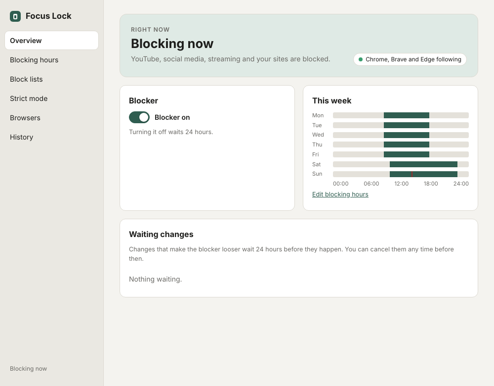

# focus-lock

A distraction blocker for Windows. The full design is in the [plan doc](https://claude.ai/artifact/A7Nu8QYV8HbXPG5BAJFfwS).

## Desktop app (`app/`)

One window on your PC to manage the whole blocker: blocking days and hours, strict mode, the block lists, your own sites and keywords, and the 72 hour early unlock. Chrome and Brave both follow the app, so you only set things once.



### Install

Setup is done by the person who holds the admin password. Follow **[docs/HELPER-SETUP.md](docs/HELPER-SETUP.md)**. In short:

1. Download **FocusLock-windows** from the latest **test** run in the Actions tab. It has `FocusLock-Setup-<version>.exe` and `dist-extension.zip`.
2. Run the setup as administrator. It installs the app for all users in `C:\Program Files\Focus Lock`, creates `C:\ProgramData\FocusLock` (standard users can read but not change or delete it), and installs the **Focus Lock** Windows service.
3. Publish `dist-extension.zip` to the Chrome Web Store as unlisted, then run `install.ps1 -ExtensionId <id>`. Chrome and Brave then install the extension themselves, and it can't be removed or turned off.
4. Optionally run `admin/browser-block/Enable-BrowserBlock.ps1` (audit first, then `-Enforce`). This blocks 10+ other browsers (Firefox, Opera, Opera GX, Vivaldi, Tor, DuckDuckGo, Waterfox, LibreWolf, Floorp, Yandex and more) with App Control for Business. It's a blocklist, so every other program keeps running.

To run it from source during development: `cd app`, `npm install`, `npm start`. With no service running, the app runs the engine itself and keeps the settings in its own folder.

### How it fits together

| Part | Runs as | What it does |
| --- | --- | --- |
| Focus Lock service (`app/service.js`, run by WinSW) | SYSTEM | Owns the settings in `C:\ProgramData\FocusLock\state.json`, applies the rules, and serves `127.0.0.1:47821` |
| Focus Lock app (`app/main.js`) | Yahya | The window and tray icon. Reads the settings from the service and sends changes to it |
| Extension | The browser | Reads the settings from the service every minute and blocks |
| `app/admin/install.ps1` | Administrator | Folder permissions, the service, and the Chrome and Brave policies |

The service only accepts changes that the rules allow, so sending it requests directly can't do more than the app window can. Web pages can't send it changes at all.

### Rules

| Change | What happens |
| --- | --- |
| Stricter: add hours, turn a list on, add a site or keyword, turn the blocker on, start or extend strict mode | Right away |
| Looser: fewer hours, turn a list off, remove a site or keyword, turn the blocker off | Waits 24 hours. Shown under **Waiting changes**, where you can cancel it |
| Any looser change during strict mode | Refused |
| Early unlock (during strict mode) | Strict mode ends 72 hours later. Your settings stay, and **Re-arm** starts strict mode again for the same length |

There are no blocking hours by default. Strict mode needs hours set and the blocker on, lasts up to 365 days, and cancels any waiting looser changes when it starts. Adult sites, pirate sites and SafeSearch are always on and can't be turned off in the app.

### How the app talks to the extension

The service answers `GET http://127.0.0.1:47821/v1/state` for the extension. The extension asks for the settings every minute and when its settings page opens. If the service isn't running, the extension keeps the last settings it got. The app window uses `/v1/view` and `/v1/change`, which need a header that web pages can't send.

Once the extension has heard from the app, its own settings page becomes read-only. While strict mode is on, the extension also checks every update and ignores one that is less strict than what it has (for example, the blocker off, fewer hours, a list off, or an early unlock without the 72 hour wait), so a fake server or an edited settings file can't switch blocking off.

## Browser extension (`extension/`)

A Manifest V3 extension for Chrome and Brave with four kinds of blocking:

| Type | What it matches | Example |
| --- | --- | --- |
| Website | A domain and all its subdomains | `netflix.com` also blocks `help.netflix.com` |
| URL | A path inside a site | `amazon.com/gp/video`, `youtube.com/shorts` |
| Keyword | Words in the address (including search queries), the page title, or page text | `fmovies`, `watch free` |
| Genre | A category of sites, and YouTube videos by their YouTube genre | `video-streaming`, YouTube `Gaming` |

Full page loads are blocked by `declarativeNetRequest` rules. The content script catches the rest: in-app navigation (YouTube is a single-page app), page titles and text, and YouTube video genres.

### Try it

1. Open `chrome://extensions` (or `brave://extensions`) and turn on **Developer mode**.
2. Click **Load unpacked** and pick the `extension` folder.
3. Click the Focus Lock icon in the toolbar to open the settings page.

### Settings page

Click the toolbar icon (or **Details > Extension options**) to open it.

When the desktop app manages the extension, this page only shows the settings. Without the app, it works on its own:

- **Blocker on.** The main switch.
- **Blocking hours.** Add time windows with days and a start and end time. There are no hours by default, so YouTube, social media and streaming sites stay open until you add some. A window that ends before it starts runs past midnight. Set the same start and end to block the whole day.
- **Strict mode.** Pick an end date and time and press **Start strict mode**. Until then you can't change the hours or turn the blocker off. You can extend it, but not shorten it. You need hours set and the blocker on to start it.
- **Early unlock.** While strict mode is on you can request an early unlock. Strict mode ends 72 hours after the request unless you cancel it. Your hours and lists stay as they are, and **Re-arm strict mode** starts it again for the same length.

### What gets blocked

| List | When |
| --- | --- |
| YouTube (all of it), social media, Netflix, Crunchyroll and other streaming sites | During your blocking hours |
| Adult sites and keywords, pirate streaming keywords | All the time, while the blocker is on |
| Google SafeSearch (adds `safe=active` to every search) | All the time, while the blocker is on |

### Configuration

The lists are in `extension/default-config.json`:

- `websites`, `urls`: lists of domains and URL prefixes.
- `keywords.url`, `keywords.title`, `keywords.text`: phrases to match. Keep `text` phrases specific to avoid false positives.
- `genres.blocked` plus `genres.sites`: which genres are on, and the sites in each (`social-media`, `video-streaming`, `adult` and others).
- `alwaysOn.genres`, `alwaysOn.keywords`: lists that apply outside the blocking hours too.
- `youtube.mode`: `"full"` (block YouTube entirely), `"genres"` (block the listed `blockedGenres`), or `"off"`. `blockShorts` blocks `/shorts`.
- `forceSafeSearch`: turns on Google SafeSearch.

A browser policy can supply the whole config as a JSON string under the extension's managed `config` key, and that replaces the defaults. The schema is in `extension/managed-schema.json`. The hours and strict mode are set on the settings page, not in this file.

### Limits

Once the helper setup is done, a standard Windows account can't uninstall the app, stop the service, change or delete the settings, change the clock, or remove the extension from Chrome or Brave. Anyone with the admin password can. Other browsers are blocked once the helper turns on the browser block. Microsoft Edge isn't covered.

## Tests

```
npm test
```

GitHub Actions runs the same tests on every push.
